# Agent-Causality

[](https://github.com/anhermon/awesome-agent-observability#evaluation-and-testing)
[](https://pypi.org/project/agent-causality/)
[](https://pepy.tech/projects/agent-causality)
[](https://www.npmjs.com/package/@psionic-labs/opencode-agent-causality)
[](https://www.npmjs.com/package/@psionic-labs/opencode-agent-causality)
[](https://www.python.org/)
[](https://github.com/Psionic-labs/Agent-Causality/blob/main/LICENSE)
[](https://psionic-labs.github.io/Agent-Causality/)
[](https://opencode.ai)

<p align="center">
  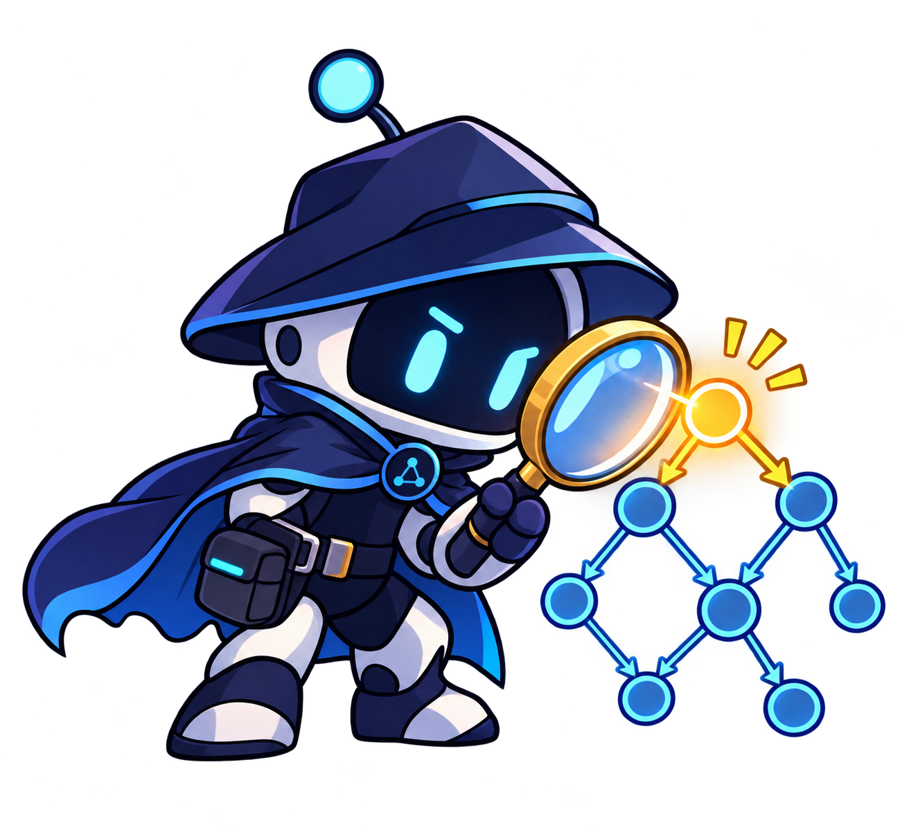
</p>

*Causal debugging for branching multi-agent systems, with capture adapters for OpenCode and LangGraph.*

Agent-Causality records what your agents did as a causal event graph, then
explains failures with grounded evidence instead of guesses.

> **This README is identical on both registries.** The full system needs
> **both** packages:
>
> - **Python (`agent-causality` on PyPI)** provides the SDK, CLI, ingest
>   receiver (`causality-opencode-ingest`), and Visual DAG Explorer
>   (`causality-explorer`). Installing only this gives you the offline demo
>   but no live OpenCode capture.
> - **JavaScript (`@psionic-labs/opencode-agent-causality` on npm)** is the
>   OpenCode plugin. It captures telemetry only. Installing only this gives
>   you events with nowhere to persist or view them.
>
> Source: <https://github.com/Psionic-labs/Agent-Causality>

[Website](https://psionic-labs.github.io/Agent-Causality/) ·
[Demo video](#demo-video) ·
[Install](#install--you-need-both-packages) ·
[30-second demo](#try-it-in-30-seconds-no-server-key-or-network) ·
[Single-run capture](#single-run-capture-ingest--opencode--explorer) ·
[Explorer](#see-it-visual-dag-explorer) ·
[OpenCode](#works-with-opencode) ·
[LangGraph](#works-with-langgraph) ·
[Research paper](#research-paper) ·
[Docs](#documentation)

---

## Demo video

[](https://www.youtube.com/watch?v=bogmzYe9Hzs)

*Full walkthrough, click the thumbnail to watch on YouTube.*

*The reel also plays in-page on the [website](https://psionic-labs.github.io/Agent-Causality/#demo), alongside the interactive walkthrough.*

*The Video follows the Single-run capture given below*

---

## Why it exists

Logs and traces show *what happened*. When several agents branch, merge, and
share state, that isn't enough to tell *what actually caused* a bad outcome.

Agent-Causality adds three things ordinary observability lacks:

| Gap in ordinary observability | What Agent-Causality records |
| --- | --- |
| Scattered logs, no links | **Explicit causal parents** for every event |
| Decisions with no reference point | **Decision contracts with baselines** |
| Guesses about "what if" | **Counterfactual replay** that tests which inputs flip the outcome |

```text
Agent execution → event capture → causal graph → slice / provenance / interaction → grounded diagnosis
```

---

## Install — you need BOTH packages

Published as `agent-causality==0.3.1`
([PyPI](https://pypi.org/project/agent-causality/)) and
`@psionic-labs/opencode-agent-causality==0.1.8`
([npm](https://www.npmjs.com/package/@psionic-labs/opencode-agent-causality)).
Requires Python 3.11+ and [`uv`](https://docs.astral.sh/uv/)
for source checkouts; PyPI/npm consumers only need `pip`/`opencode`.

```bash
# 1. Python side (SDK + receiver + explorer + CLI)
pip install agent-causality
# or, inside a uv project:
uv add agent-causality

# 2. JavaScript side (OpenCode capture plugin, telemetry only)
opencode plugin add @psionic-labs/opencode-agent-causality
```

> **npm-only installers:** you still need the PyPI package. The Visual DAG
> Explorer and the `causality-opencode-ingest` receiver ship **only** in
> `agent-causality`, not in this npm package.
>
> **PyPI-only installers:** you still need the npm package for live OpenCode
> capture. `pip install agent-causality` alone cannot observe an OpenCode
> session without the plugin.

*Optional AI explanation extra.* Needed for LLM-grounded `explain` and
*Generate AI analysis*. Requires `httpx` and `OPENROUTER_API_KEY`.

```bash
# pip consumer
pip install "agent-causality[explain]"
# uv project
uv add "agent-causality[explain]"
# source checkout
uv sync --extra explain
```

---

## Try it in 30 seconds (no server, key, or network)

```bash
uv run python examples/customer_approval.py
```

It captures two agent results and a wrong approval, then explains the failure:

```text
Outcome: approved
Diagnosis: The terminal event is marked 'failure' because the decision returned
'approved' with customer_status='eligible' and risk_score=0.2.
Evidence:
- Minimal tested chain: customer_status + risk_score -> decision -> terminal failure
- Canonical baselines were 'ineligible' and 0.8
- Interaction between customer_status and risk_score: 1.0
Limitations: the evidence does not establish why the upstream tools produced these values.
```

---

## Single-run capture: ingest → opencode → explorer

The minimal end-to-end loop. One isolated SQLite file per run keeps traces
separate. The `.causality/single-run.db` path below is just an example. Any
path works. Port `8797` avoids clashing with the default `8766` explorer.

**Terminal 1. Start the receiver.**

```bash
# PyPI install
causality-opencode-ingest --db .causality/single-run.db
# Source checkout
uv run causality-opencode-ingest --db .causality/single-run.db
```

**Terminal 2. Run one instrumented agent task** (the plugin posts automatically).

```bash
opencode run "Run the existing tests before editing. Diagnose and fix the bug in discount.py so both tests pass. Do not modify the tests. Rerun the tests and summarize the change."
```

*Optional: enable AI explanations for this project.*

```bash
uv add "agent-causality[explain]"
# pip equivalent: pip install "agent-causality[explain]"
```

**Terminal 3. Inspect the trace in the Visual DAG Explorer.**

```bash
# PyPI install
causality-explorer --db .causality/single-run.db --port 8797
# Source checkout
uv run python -m explorer.server --db .causality/single-run.db --port 8797
```

Then open <http://127.0.0.1:8797>. Each `opencode run` appends to the same
`--db` file. Use a fresh `--db` path per task to keep one trace per file.
Any filename works.

---

## See it: Visual DAG Explorer

Open a recorded run and click through it. No API key is required.
The explorer ships inside the `agent-causality` wheel.

```bash
pip install agent-causality
causality-explorer
causality-explorer --db .causality/opencode.db --port 8766
```

From a source checkout, use `uv run python -m explorer.server` with the same `--db` and `--port`.
Open <http://127.0.0.1:8766>. With no `--db`, you get the bundled demo: a failing test, the edit, and the passing retry.

The screen below shows a different run,
[`examples/replit_incident.py`](https://github.com/Psionic-labs/Agent-Causality/blob/main/examples/replit_incident.py).
It contains a freeze notice, a production delete, made-up rows, and a false
claim that rollback was impossible.
The longer write-up is [the Replit case study](https://github.com/Psionic-labs/Agent-Causality/blob/main/docs/case-study-replit.md).

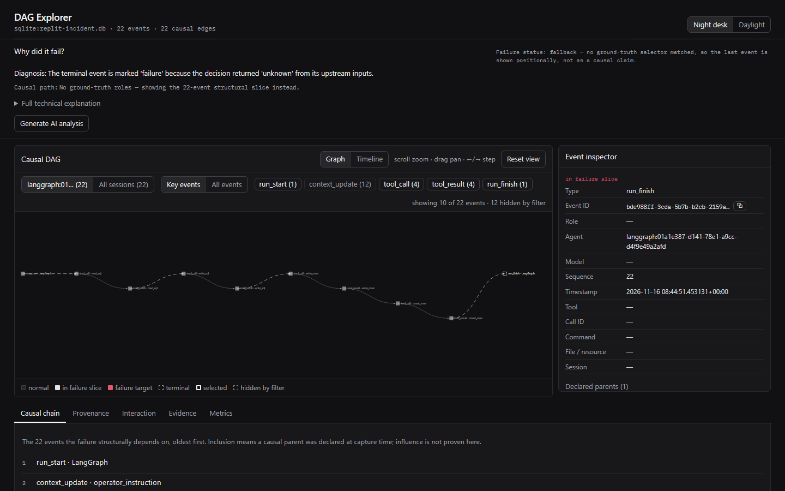

This is the debugger. The sentence at the top says why the run failed. The graph is the events and the arrows between them. The panel on the right is the event you have open. The tabs along the bottom are the lists and the counts. A short recording of the same screen is in the [gif](https://github.com/Psionic-labs/Agent-Causality/raw/main/docs/media/explorer-night-desk.gif) and the [WebM](https://github.com/Psionic-labs/Agent-Causality/raw/main/docs/media/explorer-night-desk.webm).

The words on the screen that have a special meaning are collected in [Explorer terms](https://github.com/Psionic-labs/Agent-Causality/blob/main/docs/explorer.md). That page also lists what this screen does not claim, and what is not built yet.

The rest of this section is one piece of that screen at a time.

### Choose night or day

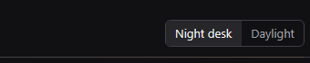

**Night desk** is the dark screen you get first. **Daylight** is the light screen. The browser keeps the one you picked.

### Read the failure in one sentence

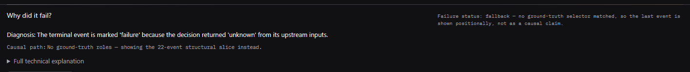

The first line answers "why did it fail?" in ordinary language. The smaller line on the right says when the file has no answer key. In that case the last event is a position, not a proven cause. **Full technical explanation** opens the stored write-up. **Generate AI analysis** asks a model for a reading and labels that reading as not evidence. It needs the `explain` extra and `OPENROUTER_API_KEY`.

### Switch between the graph and the timeline

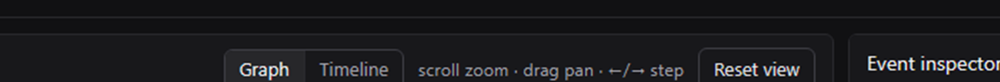

**Graph** and **Timeline** show the same events. Clicking one event selects it in both. Scroll to zoom, drag to pan, and the arrow keys step along the timeline. **Reset view** fits the drawing on the screen again.

### Hide the noise

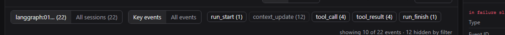

Each button is a filter. The session button limits the screen to one run. **Key events** hides the noisy status updates, here 12 of them. **All events** brings those updates back. Click a type such as `tool_call` to hide just that type. The count on the right says how many are still showing.

### Follow the arrows

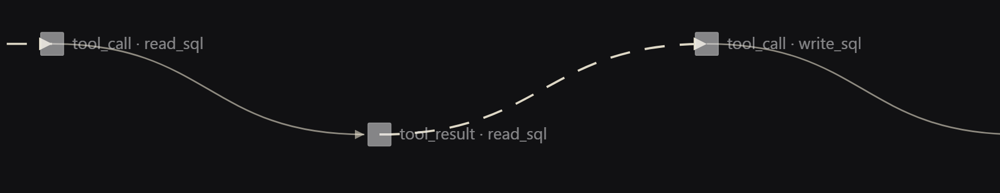

A square is one event. A solid arrow means the capture recorded that this event led to the next one. A dashed arrow means you hid the events in between. On this run, **Key events** hid 12 status updates, so those stretches are dashed. The dash is a gap in the picture, not a new cause. Hover a dash to see how many events it stands for. The key under the graph names each mark.

### Open one event

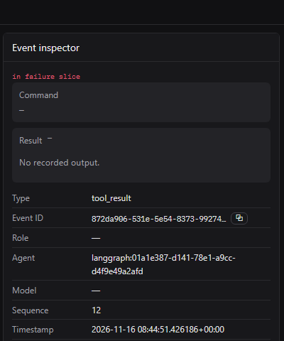

The panel on the right is the event you clicked. It names the type, the sequence number, the time, and the command or result when one was recorded. Copy the id if you need it in the CLI. The explorer never writes back to the file.

### Lay the run out in order

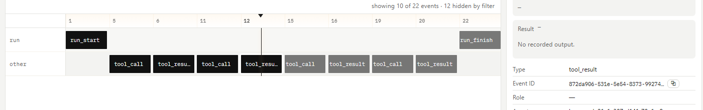

The timeline is the same run, left to right, in the order things happened. In Daylight the boxes are black and the words are white. The marker shows the selected event. `run_finish` stays an outline, so the end of the run is easy to spot. Drag the number line, or press the arrow keys, to move the selection.

### Count the capture, then read the tools

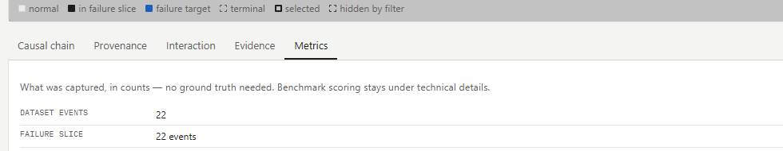

**Metrics** counts what was recorded. It is not a score of who was at fault. Scoring against an answer key stays folded away, because many live runs have no answer key.

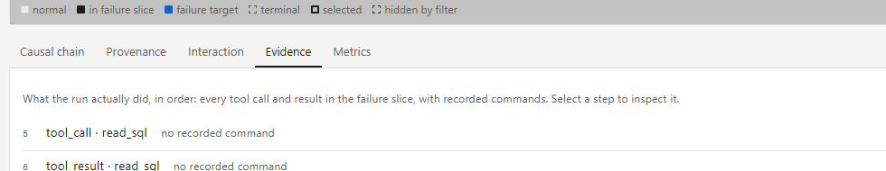

**Evidence** lists each tool call and its result, in order. Click a row and that event opens in the inspector. **Provenance** lists files named in the capture. **Interaction** lists places where the run split or joined, and says so when the run is a straight line. **Causal chain** lists the events the failure depends on, up to 80 rows.

The acceptance steps are in [TEST.md §29](https://github.com/Psionic-labs/Agent-Causality/blob/main/TEST.md).

---

## Use it with your agents

```python
import causality

causality.init(".causality/events.db")

@causality.agent(role="risk_checker")
def check_risk(customer): ...

@causality.merge_decision(...)
def approve(customer_status, risk_score): ...
```

See
[`examples/customer_approval.py`](https://github.com/Psionic-labs/Agent-Causality/blob/main/examples/customer_approval.py)
for a complete runnable example.

---

## Works with OpenCode

Capture live coding-agent sessions. Telemetry is fail-open, so it never
interrupts your agent. **Requires both packages** (receiver from PyPI,
plugin from npm).

```bash
# Terminal 1: receiver (PyPI install; source checkout: uv run causality-opencode-ingest ...)
causality-opencode-ingest --db .causality/opencode.db
# Terminal 2: agent (plugin posts automatically)
opencode run "Read RESEARCH.md, implement sort_items in task.py as recommended, run the test script."
# Terminal 3: Visual DAG
causality-explorer --db .causality/opencode.db
```

Install `agent-causality` from PyPI. Add the OpenCode plugin from npm with
`opencode plugin add @psionic-labs/opencode-agent-causality`. Start the
receiver, run OpenCode, then launch `causality-explorer` and inspect the
recorded trace. No repository clone is needed.

> A representative committed result (`stale_research`, OpenCode `1.19.0`)
> reads `completed (exit 0), 331 events, capture coverage 1.0, diagnosis scored`
> (see `benchmark/results/opencode/opencode.md`). No video artifact ships
> with this release.
> [Setup guide →](https://psionic-labs.github.io/Agent-Causality/opencode.html)

### What the plugin captures

The npm plugin forwards OpenCode's global event stream plus explicit hooks
(`tool.execute.before/after`, `permission.ask`, `command.execute.before`,
`chat.message`, `chat.params`). The Python receiver maps these onto canonical
events, registers file writes with Resource-Version machinery, and redacts
secrets before SQLite persistence. It is telemetry capture only. The
Explorer and CLI live in the PyPI distribution.

---

## Works with LangGraph

`CausalityCallbackHandler` is a LangChain callback handler. Point your
graph's `config` at it and every node, tool, and LLM run lands in the
causal graph. Capture is fail-open. `parent_run_id` containment becomes
explicit causal edges, and unknown parents are dropped rather than invented.

```python
from adapters.langgraph import CausalityCallbackHandler
from storage.sqlite import SQLiteEventStore

store = SQLiteEventStore(".causality/langgraph.db")
handler = CausalityCallbackHandler(store)

app.invoke(inputs, config=handler.config())
```

For a worked example, [`examples/replit_incident.py`](https://github.com/Psionic-labs/Agent-Causality/blob/main/examples/replit_incident.py)
replays the documented July 2025 Replit incident as 22 causally-validated
events. The incident includes a violated freeze, deleted production rows,
fabricated data, and a false rollback claim. See
[the Replit case study](https://github.com/Psionic-labs/Agent-Causality/blob/main/docs/case-study-replit.md)
for the longer write-up.
[Adapter guide →](https://psionic-labs.github.io/Agent-Causality/langgraph.html)

---

## Benchmarks

Offline, provider-neutral suite (`uv run causality-benchmark ...`) plus a
real OpenCode coding-agent benchmark. Full results in
[`docs/benchmarks.md`](https://github.com/Psionic-labs/Agent-Causality/blob/main/docs/benchmarks.md)
and `benchmark/results/`.

- Five deterministic scenarios: **5/5 pass**.
- Experiment 2 (shared-state recovery): **100/100**.
- Experiment 3 (semantic-port vs raw deletion): **20/20** semantic-port
  successes; raw-deletion failure rate met target.
- Experiment 1 (offline): passes; external Fastino run is
  provider-blocked and deferred (no structured-output capability).
- Real OpenCode benchmark (5 runs across 5 tasks, OpenCode `1.19.0`): capture
  micro/macro-average `1.0`; cause recall mean `0.3` (structural-slice
  ancestry under explicit-evidence edges only); joint ancestry `0.0`.
  Genuine causal interaction is unsupported from live traces.

*Terminology matters here. Live-trace branch results are reported as
`joint ancestry`, not causal interaction. Minimal slices are a
`required-cause preservation proxy`, not causal minimality.*

---

## Research paper

[Agent-Causality: Declared Dependency Tracing and Counterfactual Sensitivity Analysis for Multi-Agent Systems](https://github.com/Psionic-labs/Agent-Causality/blob/main/research_paper/agentic_causality_paper.pdf), by Vasant Kumar Mogia, Psionics. The file is [`research_paper/agentic_causality_paper.pdf`](https://github.com/Psionic-labs/Agent-Causality/blob/main/research_paper/agentic_causality_paper.pdf). Source is [`research_paper/main.tex`](https://github.com/Psionic-labs/Agent-Causality/blob/main/research_paper/main.tex).

The paper describes declared parent links, structural slices, provenance grades, decision contracts, and counterfactual replay of registered merge decisions.

Each name links to the PDF page where that section starts.

1. [Introduction](https://github.com/Psionic-labs/Agent-Causality/blob/main/research_paper/agentic_causality_paper.pdf#page=1)
2. [The problem](https://github.com/Psionic-labs/Agent-Causality/blob/main/research_paper/agentic_causality_paper.pdf#page=2)
3. [The core idea](https://github.com/Psionic-labs/Agent-Causality/blob/main/research_paper/agentic_causality_paper.pdf#page=2)
4. [How the system works](https://github.com/Psionic-labs/Agent-Causality/blob/main/research_paper/agentic_causality_paper.pdf#page=3)
5. [Fixture walkthrough: customer approval](https://github.com/Psionic-labs/Agent-Causality/blob/main/research_paper/agentic_causality_paper.pdf#page=5)
6. [What the tool supports on its own](https://github.com/Psionic-labs/Agent-Causality/blob/main/research_paper/agentic_causality_paper.pdf#page=6)
7. [Combinations with other tools](https://github.com/Psionic-labs/Agent-Causality/blob/main/research_paper/agentic_causality_paper.pdf#page=6)
8. [Case study: a documented agent incident](https://github.com/Psionic-labs/Agent-Causality/blob/main/research_paper/agentic_causality_paper.pdf#page=8)
9. [Evaluation](https://github.com/Psionic-labs/Agent-Causality/blob/main/research_paper/agentic_causality_paper.pdf#page=8)
10. [Limitations and future work](https://github.com/Psionic-labs/Agent-Causality/blob/main/research_paper/agentic_causality_paper.pdf#page=10)
11. [Related work](https://github.com/Psionic-labs/Agent-Causality/blob/main/research_paper/agentic_causality_paper.pdf#page=11)
12. [Conclusion](https://github.com/Psionic-labs/Agent-Causality/blob/main/research_paper/agentic_causality_paper.pdf#page=11)

---

## Documentation

| Topic | Link |
| --- | --- |
| Getting started | [GETTING_STARTED.md](https://github.com/Psionic-labs/Agent-Causality/blob/main/GETTING_STARTED.md) |
| OpenCode integration | [OpenCode guide](https://psionic-labs.github.io/Agent-Causality/opencode.html) |
| LangGraph integration | [LangGraph guide](https://psionic-labs.github.io/Agent-Causality/langgraph.html) |
| Replit incident case study | [docs/case-study-replit.md](https://github.com/Psionic-labs/Agent-Causality/blob/main/docs/case-study-replit.md) |
| Explorer terms, limits, and later work | [docs/explorer.md](https://github.com/Psionic-labs/Agent-Causality/blob/main/docs/explorer.md) |
| CLI and Python reference | [docs/reference.md](https://github.com/Psionic-labs/Agent-Causality/blob/main/docs/reference.md) |
| Benchmarks and results | [docs/benchmarks.md](https://github.com/Psionic-labs/Agent-Causality/blob/main/docs/benchmarks.md) |
| Scope and limits | [docs/reference.md](https://github.com/Psionic-labs/Agent-Causality/blob/main/docs/reference.md) |
| Research paper | [`research_paper/agentic_causality_paper.pdf`](https://github.com/Psionic-labs/Agent-Causality/blob/main/research_paper/agentic_causality_paper.pdf) |
| Research background | [docs/thesis.md](https://github.com/Psionic-labs/Agent-Causality/blob/main/docs/thesis.md), [docs/research-memo.md](https://github.com/Psionic-labs/Agent-Causality/blob/main/docs/research-memo.md) |
| Contributing and tests | [TEST.md](https://github.com/Psionic-labs/Agent-Causality/blob/main/TEST.md), [CONTRIBUTING.md](https://github.com/Psionic-labs/Agent-Causality/blob/main/CONTRIBUTING.md) |
| Licensing and commercial use | [LICENSING.md](https://github.com/Psionic-labs/Agent-Causality/blob/main/LICENSING.md) |
| Release notes | [CHANGELOG.md](https://github.com/Psionic-labs/Agent-Causality/blob/main/CHANGELOG.md) |
